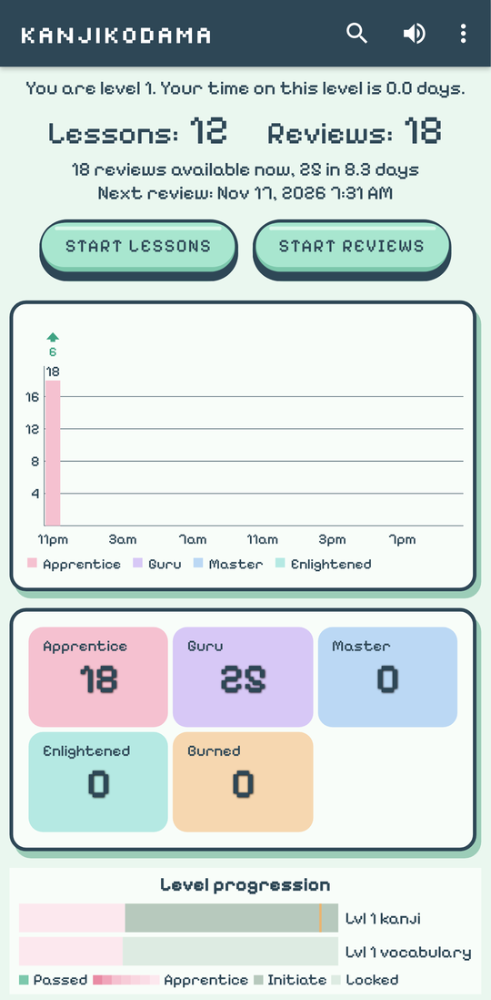
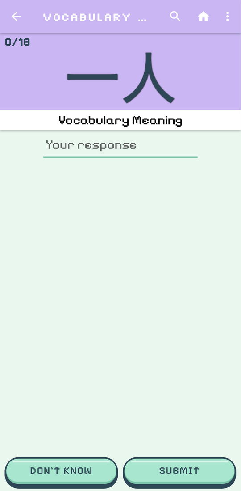
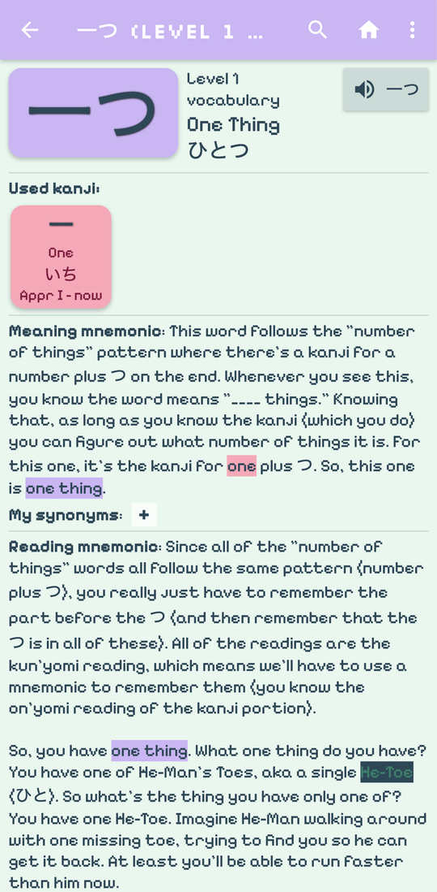
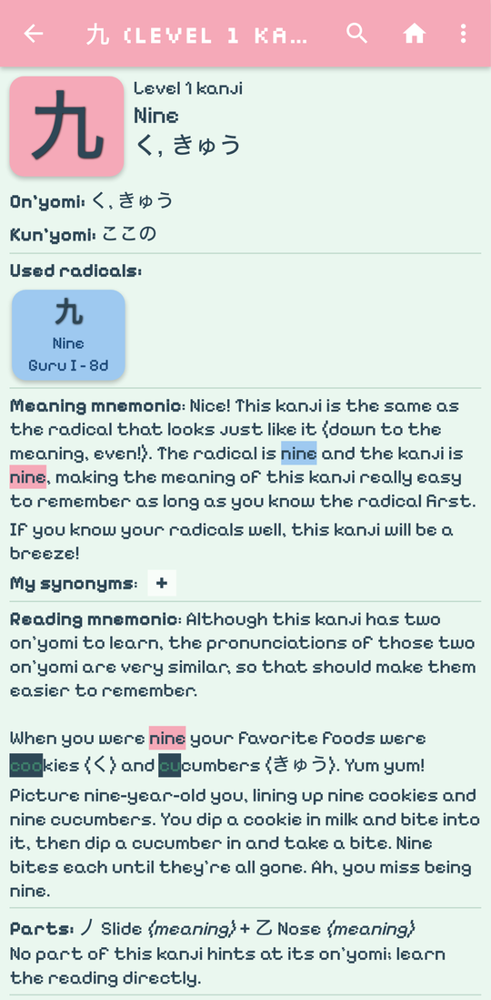

# KanjiKodama 漢字木霊

**A cosy little kanji garden: learn radicals, kanji and vocabulary with spaced repetition,
offline, on Android and iPhone.**

[**Open the web app**](https://luksgrin.xyz/KanjiKodama/) ·
[**Download for Android**](https://github.com/luksgrin/KanjiKodama/releases/latest) ·
[What's inside](#whats-inside) · [Credits](#credits)

## Get it

| | |
|---|---|
| 🤖 **Android** | Download `kanjikodama-<version>.apk` from the [latest release](https://github.com/luksgrin/KanjiKodama/releases/latest) and open it (allow installing from your browser or file manager when Android asks). From then on the app updates itself: when a new version is out it offers to download and install it, and you confirm with a tap; your progress stays. (Versions before 0.6.2 can't do this yet: install 0.6.2 or later by hand once.) Android 7.0 or newer. |
| 🍎 **iPhone / iPad** | Open [luksgrin.xyz/KanjiKodama](https://luksgrin.xyz/KanjiKodama/) in Safari, tap **Share**, then **Add to Home Screen**. |
| 💻 **Any browser** | Just open [luksgrin.xyz/KanjiKodama](https://luksgrin.xyz/KanjiKodama/). Chrome and Edge can install it as an app too. |

After the first start everything works offline. The web app updates itself the next time you open
it online. Moving to another phone? Save your progress to a file on the old one
(Settings → Progress) and restore it on the new one.

## What's inside

- 🌱 **Lessons and reviews, offline.** Radicals, kanji and vocabulary in WaniKani's level order,
  with mnemonics, context sentences and audio. No account needed; your progress stays on your device.
- 🧭 **A friendly start.** A short, skippable guide on the first start: pick your font, learn how
  the quizzes work, choose your path and where to begin.
- ⛩️ **A gentle SRS.** Items climb from Apprentice to Burned. Pass 90 % of a level's kanji to
  unlock the next one. Every question says what it wants: 意 meaning, 音 on'yomi or 訓 kun'yomi.
- 🔊 **Parts and sounds.** Kanji pages show each kanji's components, which one carries the sound,
  how reliable that sound is, and its other kanji in the same sound family.
- ✍️ **Writing practice.** Draw kanji and radicals stroke by stroke, traced or from memory, with
  each stroke checked and its own writing progress.
- 🌳 **Study garden.** Your streak and a pixel calendar where every study day grows a little plant.
- 🧩 **Search by parts.** Tap a kanji's components to find it.
- 🖌️ **Stroke order and pitch accent,** plus an Anki-style self-grading mode, self-study
  sessions, star ratings and plenty of display and keyboard settings.
- 🔎 **Easy on the eyes.** Make the text up to 150 % bigger, or switch from the pixel font to
  DotGothic16 or the smooth Zen Maru Gothic (Settings → Display settings → Text size and font).
- 🗾 **Two paths.** Follow WaniKani's 60 levels, or switch to JLPT order (N5 → N1). JLPT order
  includes 259 kanji WaniKani never taught, a placement test, and "fast travel" to jump ahead.
- 💾 **Your data, your way.** Save and restore progress as a file (Google Drive works too), import
  your progress from WaniKani, or connect to a WaniKani-compatible server such as
  [OpenKani](https://github.com/sarmientoF/OpenKani).
- 📱 **Android extras.** A home-screen widget, review notifications and automatic backups.
- 🌿 **Pixel Forest theme.** Pastel greens and pixel fonts, in light, dark and pure black.

## Credits

KanjiKodama is made by [luksgrin](https://github.com/luksgrin), with infinite thanks to
[Smouldering Durtles](https://github.com/jerryhcooke/smouldering_durtles) by Jerry Cooke and
Flaming Durtles by Ernst Jan Plugge, on which it is based (both Apache License 2.0, see
[NOTICE](NOTICE)). Lesson content comes from [WaniKani](https://www.wanikani.com/);
open data from EDRDG (KANJIDIC2, KRADFILE, JMdict) and KanjiVG; fonts Silkscreen,
Pixelify Sans, DotGothic16 and Zen Maru Gothic (SIL Open Font License). The app's About screen lists everything.

Thank you also to [Kanji Dojo](https://github.com/syt0r/Kanji-Dojo) by syt0r, whose ideas inspired
writing practice, the study garden, search by parts and the pure black theme (written anew for
KanjiKodama; no Kanji Dojo code is used).

KanjiKodama is not affiliated with or endorsed by Tofugu or WaniKani.

Building it yourself, running the tests or making a release: see
[docs/development.md](docs/development.md).

## License

Apache License 2.0, see [LICENSE](LICENSE).
